# QMK Keymap

## Installation

1. [Set up qmk environment](https://docs.qmk.fm/newbs_getting_started)
2. Clone this repository

```bash
git clone https://github.com/jesalx/qmk-keymap
```

3. Use [external userspace](https://docs.qmk.fm/newbs_external_userspace) by running the following command while replacing `path/to/qmk-keymap` with the relative path to the cloned repository

```bash
qmk config user.overlay_dir="$(realpath path/to/qmk-keymap)"
```

4. Compile and flash the keymap

```bash
qmk flash -kb zsa/voyager -km jesal
```

If `dfu-util` is not installed, run the flash command inside the Nix dev shell (which also provides `qmk`, `go-task`, `keymap-drawer`, `clang-format` and `actionlint`):

```bash
nix develop -c qmk flash -kb zsa/voyager -km jesal
```

## Editing the layout

Edit only `keyboards/zsa/voyager/keymaps/jesal/keymap.c`. `zsa_voyager_jesal.json` (for viewing at [config.qmk.fm](https://config.qmk.fm)) and `keymap.svg` (the image below) are generated from it, as is the leader table at the bottom of this file (from `super_leader.def`). Regenerate all of them with [go-task](https://taskfile.dev):

```bash
task
```

## Development

Tools are provided by the Nix flake (`qmk`, `go-task`, `keymap-drawer`, `clang-format`, `actionlint`, `dfu-util`), pinned by `flake.lock`. Enter the shell with `nix develop`, or run `direnv allow` once to enter it automatically on `cd`.

| Command | Description |
| --- | --- |
| `task` | Regenerate the JSON, SVG and leader table |
| `task check` | Run every CI lint: `actionlint`, `qmk lint` and the clang-format check |
| `task format` | Format the C sources with clang-format |
| `task flash` | Compile and flash the keymap |

## CI and releases

Every push and pull request builds the firmware and checks that the lints pass, the flake evaluates, and the generated files are up to date. The build uses the `qmk_firmware` commit pinned in `flake.lock`.

A push to `main` that changes the firmware inputs (`qmk.json`, `keyboards/`, `modules/`, `*.c` or `*.h`) and passes CI publishes a GitHub release tagged `vYYYY.MM.DD-<sha>` with the firmware `.bin` attached.

A weekly workflow (`update.yaml`) runs `nix flake update`, builds the result on a branch, and merges it into `main` only if that build passes.

## Layout



## Leader sequences

Tap the left thumb key (tap = leader, hold = GUI), then the keys below. Sequences are defined in `keyboards/zsa/voyager/keymaps/jesal/super_leader.def`.

<!-- leader:start -->
| Keys | Output | Description |
| --- | --- | --- |
| `L T` | `RM_TOGG` | Toggle RGB lighting |
| `L G` | `RGB_M_G` | Gradient lighting effect |
| `L U` | `RGBVALU` | Increase lighting brightness |
| `L D` | `RGBVALD` | Decrease lighting brightness |
| `L R` | `RGBRAND` | Random lighting palette |
| `L L` | `RGBDEF` | Reset lighting to the default |
| `T S` | `SOCDTOG` | Toggle SOCD cleaning |
| `T N` | `NK_TOGG` | Toggle NKRO |
| `T D` | `DB_TOGG` | Toggle QMK debug output |
| `F 1` | `KC_F1` | F1 |
| `F 2` | `KC_F2` | F2 |
| `F 3` | `KC_F3` | F3 |
| `F 4` | `KC_F4` | F4 |
| `F 5` | `KC_F5` | F5 |
| `F 6` | `KC_F6` | F6 |
| `F 7` | `KC_F7` | F7 |
| `F 8` | `KC_F8` | F8 |
| `F 9` | `KC_F9` | F9 |
| `F 0` | `KC_F10` | F10 |
| `F -` | `KC_F11` | F11 |
| `B B` | `KC_WBAK` | Browser back |
| `B R` | `KC_WREF` | Browser refresh |
| `B S` | `SRCHSEL` | Search the selection (or clipboard) in a new tab |
| `B N` | `XOS_NEWTAB` | New tab |
| `B C` | `XOS_CLOSETAB` | Close tab |
| `B T` | `XOS_REOPENTAB` | Reopen closed tab |
| `B U` | `URLCOPY` | Copy the page URL |
| `M P` | `KC_MPLY` | Play or pause media |
| `M N` | `KC_MNXT` | Next track |
| `M B` | `KC_MPRV` | Previous track |
| `M U` | `KC_VOLU` | Volume up |
| `M D` | `KC_VOLD` | Volume down |
| `M M` | `KC_MUTE` | Mute |
| `J B` | `"jj b s  -r @-" SS_TAP(X_LEFT) SS_TAP(X_LEFT) SS_TAP(X_LEFT) SS_TAP(X_LEFT) SS_TAP(X_LEFT) SS_TAP(X_LEFT)` | jj bookmark set at @-, cursor on the name |
| `J C` | `"jj commit -m \"\"" SS_TAP(X_LEFT)` | jj commit with the cursor inside the quotes |
| `J D` | `"jj desc -m \"\"" SS_TAP(X_LEFT)` | jj describe with the cursor inside the quotes |
| `I N` | `"Jesal"` | Type name |
| `I W` | `"jesal.dev"` | Type website |
| `I G` | `"github.com/jesalx"` | Type GitHub URL |
<!-- leader:end -->
